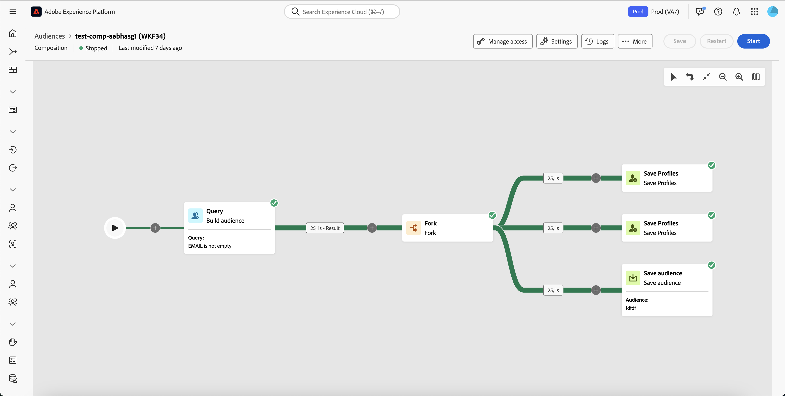
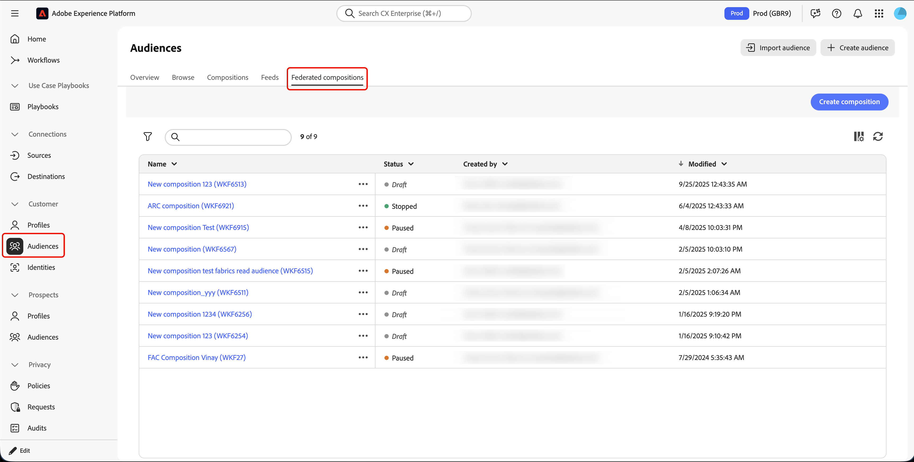
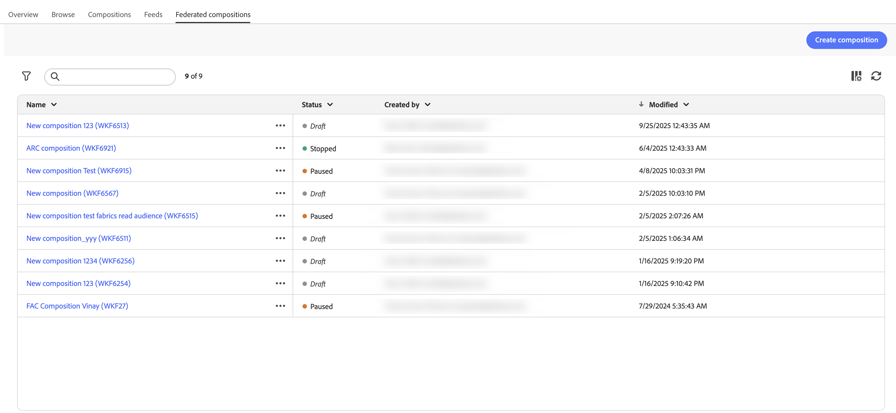
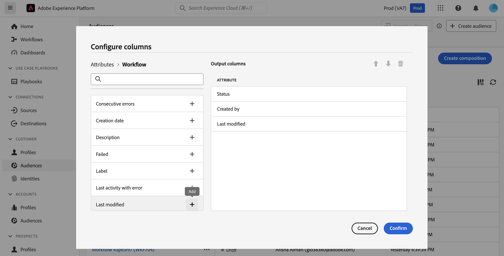
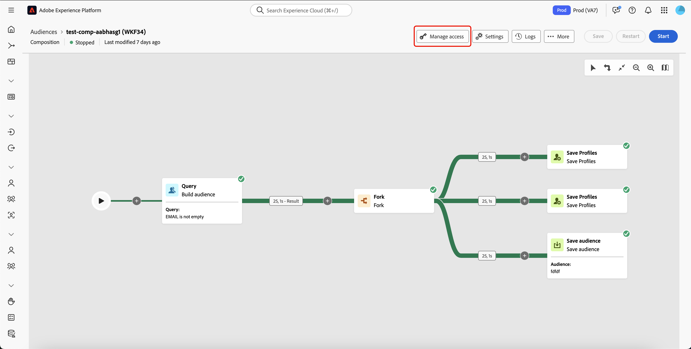
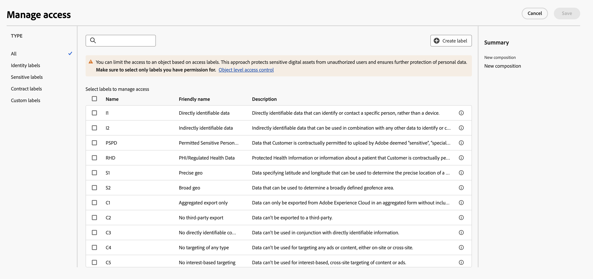

# 合成概述

>[!AVAILABILITY]
>
>要访问构成，您需要以下权限之一：
>
>-**管理联合合成**
>-**查看联合构成**
>
>有关所需权限的更多信息，请阅读[访问控制指南](/help/governance-privacy-security/access-control.md)。

联合受众构成功能可让您创建构成项目，通过在可视化画布中组合各类活动，以构建受众。 在创建构成项目后，生成的受众将被保存至 Adobe Experience Platform，并可用于 Experience Platform 的目标定位功能以及 Adobe Journey Optimizer，实现精准客户投放。

{zoomable="yes"}{width="70%"}

## 组合组件 {#components}

联合受众组合中的组合由以下部分组成：

- **[!UICONTROL 活动]**：活动是要执行的任务，在构成中用图标表示。
- **[!UICONTROL 过渡]**：过渡将源活动链接到目标活动并定义它们的顺序。 过渡中包含的信息存储在工作表中。 每个构成都使用多个工作台。 这些表中传送的数据可在整个合成生命周期中使用。

## 访问和管理构成 {#access}

>[!CONTEXTUALHELP]
>id="dc_composition_list"
>title="构成"
>abstract="在此屏幕中可访问整个构成列表、检查它们当前的状态、上次/下次执行日期以及创建新构成。"

您可以通过 Adobe Experience Platform 中的&#x200B;**[!UICONTROL 受众]**&#x200B;菜单，进入&#x200B;**[!UICONTROL 客户]**&#x200B;部分下的&#x200B;**[!UICONTROL 联合构成]**&#x200B;标签页访问构成项目。

{zoomable="yes"}{width="70%"}

在此屏幕中，您可以查看有关合成的信息并创建新合成。

{zoomable="yes"}{width="70%"}

| 字段 | 描述 |
| ----- | ----------- |
| **[!UICONTROL 名称]** | 构成的名称。 如果选择构成，则可以编辑构成。 有关创建和编辑合成的详细信息，请阅读[创建合成指南](/help/compositions/create-composition.md)。 |
| **[!UICONTROL 状态]** | 构成状态。 可能的值包括[!UICONTROL 草稿]、[!UICONTROL 进行中]、[!UICONTROL 已停止]、[!UICONTROL 已暂停]和[!UICONTROL 错误]。 <ul><li>**[!UICONTROL 草稿]**：已创建并保存合成。</li><li>**[!UICONTROL 进行中]**：合成已执行，当前正在运行。</li><li>**[!UICONTROL 已停止]**：组合执行已完成并已停止。</li><li>**[!UICONTROL 已暂停]**：合成执行已暂停。</li><li>**[!UICONTROL 错误]**：合成执行遇到错误。 如需查看有关错误的详细信息，请打开该构成项目并访问日志。</li></ul> 要了解如何启动或停止合成，请阅读[创建合成指南](./create-composition.md#monitor-logs)。 |
| **[!UICONTROL 创建者]** | 创建构成的人的姓名和电子邮件地址。 |
| **[!UICONTROL 已修改]** | 上次更新构成时的日期和时间。 |

您还可以通过选择合成名称旁边的按钮对该合成执行快速操作。

| 操作 | 描述 |
| ------ | ----------- |
| **[!UICONTROL 重复]** | 复制所选合成。 |
| **[!UICONTROL 删除]** | 删除所选合成。 |
| **[!UICONTROL 添加到包]** | 在沙盒之间移动合成。 有关此功能的详细信息，请阅读[沙盒工具指南](https://experienceleague.adobe.com/en/docs/experience-platform/sandbox/ui/sandbox-tooling)。 |

您可以通过搜索列表，并按状态或最近处理日期进行筛选，从而优化列表并快速找到所需的构成项目。

您还可以通过添加或移除列来自定义该列表。 为此，请点击&#x200B;**[!UICONTROL 配置列]**&#x200B;按钮，添加或移除所需的输出列。

{zoomable="yes"}{width="70%"}

### 应用访问标签 {#access-labels}

要为特定构成项目应用访问标签，请先选择该构成项目，然后点击&#x200B;**[!UICONTROL 管理访问权限]**。

{zoomable="yes"}{width="70%"}

**[!UICONTROL 管理访问权限]**&#x200B;弹出窗口将会显示。 在此页面，您可以为构成项目应用相应的访问权限标签和数据治理标签。

{zoomable="yes"}{width="70%"}

| 标签类型 | 描述 |
| ---------- | ----------- |
| 合同标签 | 合同标签（“C”标签）用于对具有合约义务或与您组织的数据治理政策相关的数据进行分类。 |
| 身份标识标签 | 身份标识标签（“I”标签）用于对可识别或联系特定个人的数据进行分类。 |
| 敏感标签 | 敏感标签（“S”标签）用于对您和/或您的组织认为敏感的数据进行分类。 |
| 合作伙伴生态系统标签 | 合作伙伴生态系统标签用于对来自您组织外部来源的数据进行分类。 |

有关访问权限标签和数据治理标签的更多信息，请参阅[数据使用标签词汇表](https://experienceleague.adobe.com/zh-hans/docs/experience-platform/data-governance/labels/reference)。

## 创建 {#create}

您可以使用受众组合为Adobe Experience Platform创建组合。 有关详细信息，请阅读[创建合成指南](./create-composition.md)。

## 后续步骤

阅读本指南后，您已了解如何访问、管理并为构成项目创建访问标签。 有关整体管理受众的更多信息，请参阅[受众指南](../start/audiences.md)。
