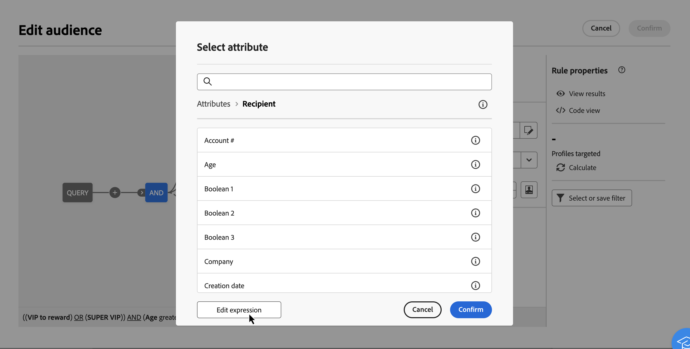
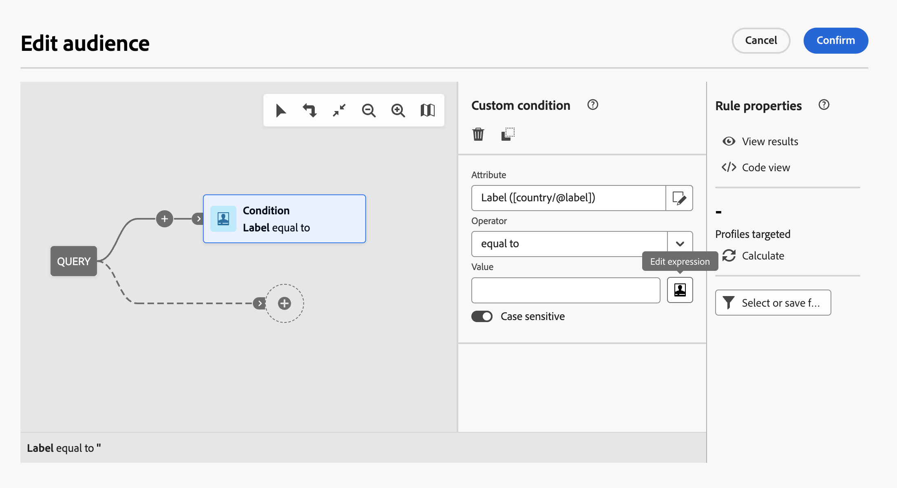
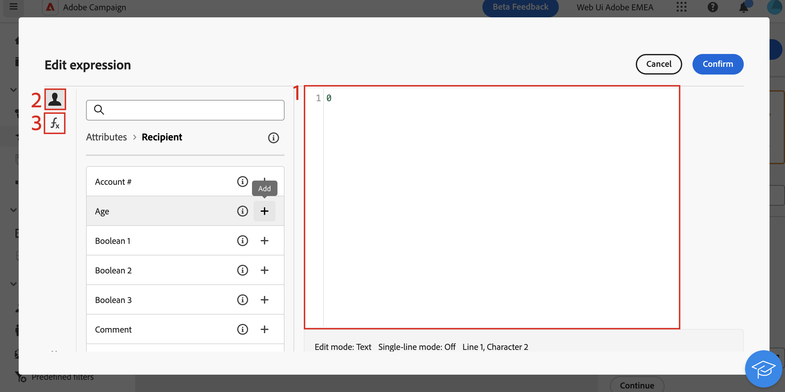
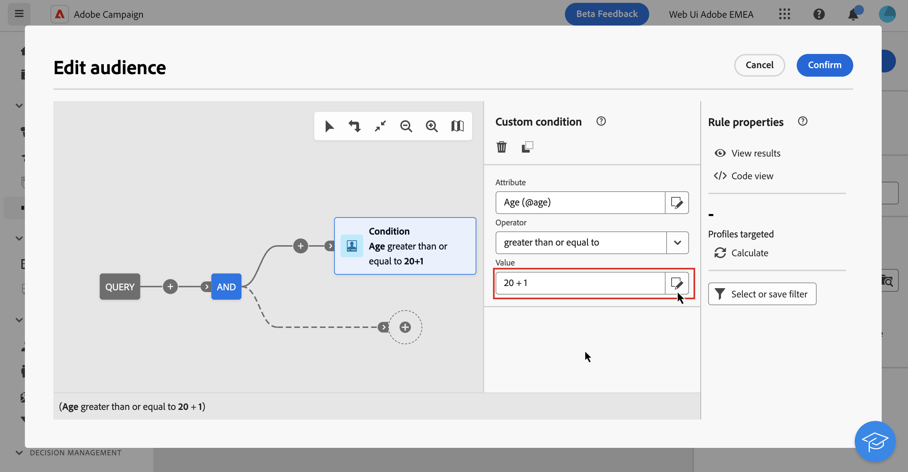

# 表达式编辑器概述 {#expression}

编辑表达式需要手动输入条件以形成规则。 利用此模式，可使用高级函数，这些函数允许您处理用于执行特定查询（如处理日期、字符串、数字字段、排序等）的值。

## 使用表达式编辑器 {#edit}

表达式编辑器可从查询建模器&#x200B;**[!UICONTROL 编辑表达式]**&#x200B;按钮获得，在配置自定义条件时，该按钮可用于&#x200B;**[!UICONTROL 属性]**&#x200B;和&#x200B;**[!UICONTROL 值]**&#x200B;字段。

| 从&#x200B;**[!UICONTROL 属性]**&#x200B;字段访问 | 从&#x200B;**[!UICONTROL 值]**&#x200B;字段访问 |
|  ---  |  ---  |
| {zoomable="yes"}{width="200" align="center" zoomable="yes"} | {zoomable="yes"}{width="200" align="center" zoomable="yes"} |

表达式编辑器提供：

* 定义了表达式的&#x200B;**输入字段(1)**。
* 可用&#x200B;**字段(2)**&#x200B;的列表，这些字段可用于表达式中，并与查询的架构（也称为定向维度）相对应。
* **辅助函数 (3)**，按类别排序。

通过直接在输入字段中输入表达式来编辑表达式。 要添加字段或辅助函数，请将光标置于要添加该字段或辅助函数的表达式中，然后选择+按钮。

{zoomable="yes"}

表达式就绪后，选择&#x200B;**[!UICONTROL 确认]**。 表达式将显示在所选字段中。 要对其进行编辑，请打开表达式编辑器并进行所需的更改。

以下示例显示为&#x200B;**[!UICONTROL 值]**&#x200B;字段配置的表达式。 要编辑它，您需要使用&#x200B;**[!UICONTROL 编辑表达式]**&#x200B;按钮打开表达式编辑器。

{zoomable="yes"}

## 辅助函数

利用查询编辑工具，可使用高级函数根据所需结果和所处理数据的类型执行复杂筛选。 可以使用以下函数：

### 日期

日期函数用于操作日期或时间值。

>[!BEGINTABS]

>[!TAB Google BigQuery]

| 名称 | 描述 | 句法 | 示例 |
| ---- | ----------- | ------ | ------- |
| **AddYears** | 将指定的年数添加到提供的日期时间。 | AddYears（&lt;日期时间>， &lt;数字>） | AddYears(&quot;2019-12-25 15:30:00&quot;， 3) |
| **AddMonths** | 将指定的月数添加到提供的日期时间。 | AddMonths（&lt;日期时间>， &lt;数字>） | AddMonths(&quot;2019-12-25 15:30:00&quot;， 6) |
| **AddDays** | 将指定的天数添加到提供的日期时间。 | AddDays（&lt;日期时间>， &lt;数字>） | AddDays(&quot;2019-12-25 15:30:00&quot;， 10) |
| **AddHours** | 将指定的小时数添加到提供的日期时间。 | AddHours（&lt;日期时间>， &lt;数字>） | AddHours(&quot;2019-12-25 15:30:00&quot;， 3) |
| **AddMinutes** | 将指定的分钟数添加到提供的日期时间。 | AddMinutes（&lt;日期时间>， &lt;数字>） | AddMinutes(&quot;2019-12-25 15:30:00&quot;， 32) |
| **AddSeconds** | 将指定的秒数添加到提供的日期时间。 | AddSeconds（&lt;日期时间>， &lt;数字>） | AddSeconds(&quot;2019-12-25 15:30:00&quot;， 37) |
| **SubYears** | 将指定的年数减去提供的日期时间。 | SubYears（&lt;日期时间>， &lt;数字>） | SubYears(&quot;2019-12-25 15:30:00&quot;， 3) |
| **SubMonths** | 将指定的月数减去提供的日期时间。 | SubMonths（&lt;日期时间>， &lt;数字>） | SubMonths(&quot;2019-12-25 15:30:00&quot;， 6) |
| **SubDays** | 将指定的天数减去提供的日期时间。 | SubDays（&lt;日期时间>， &lt;数字>） | SubDays(&quot;2019-12-25 15:30:00&quot;， 10) |
| **SubHours** | 将指定的小时数减去提供的日期时间。 | SubHours（&lt;日期时间>， &lt;数字>） | SubHours(&quot;2019-12-25 15:30:00&quot;， 3) |
| **SubMinutes** | 将指定的分钟数减去提供的日期时间。 | SubMinutes（&lt;日期时间>， &lt;数字>） | SubMinutes(&quot;2019-12-25 15:30:00&quot;， 32) |
| **SubSeconds** | 将指定的秒数减去提供的日期时间。 | SubSeconds（&lt;日期时间>， &lt;数字>） | SubSeconds(&quot;2019-12-25 15:30:00&quot;， 37) |
| **Year** | 从给定的datetime对象中提取年。 | Year（&lt;日期时间>） | 年(“2019-12-15 15:30:00”) |
| **Month** | 从给定的datetime对象中提取月份。 | Month（&lt;日期时间>） | 月份(“2019-12-15 15:30:00”) |
| **Day** | 从给定的datetime对象中提取日。 | Day（&lt;日期时间>） | Day(&quot;2019-12-15 15:30:00&quot;) |
| **DayOfYear** | 从给定的datetime对象中提取每年的某一日。 例如，如果提供的日期时间是2月2日，则会返回33。 | DayOfYear（&lt;日期时间>） | DayOfYear(&quot;2019-12-15 15:30:00&quot;) |
| **WeekDay** | 从给定的datetime对象中提取星期几，作为0到6之间的数字，0表示星期日。 | Year（&lt;日期时间>） | 年(“2019-12-15 15:30:00”) |
| **Hour** | 从给定的datetime对象中提取小时值。 | Year（&lt;日期时间>） | 年(“2019-12-15 15:30:00”) |
| **Minute** | 从给定的datetime对象中提取分钟值。 | Year（&lt;日期时间>） | 年(“2019-12-15 15:30:00”) |
| **Second** | 从给定的datetime对象中提取第二个值。 | Year（&lt;日期时间>） | 年(“2019-12-15 15:30:00”) |
| **YearsDiff** | 查找给定日期时间之间的差异，粒度为年。 | YearsDiff(&lt;DATETIME>， &lt;DATETIME>) | YearsDiff(&quot;2019-12-25 15:30:00&quot;， &quot;2018-10-14 18:35:27&quot;) |
| **MonthsDiff** | 查找给定日期时间之间的差异，粒度为月。 | MonthsDiff(&lt;DATETIME>， &lt;DATETIME>) | MonthsDiff(&quot;2019-12-25 15:30:00&quot;， &quot;2018-10-14 18:35:27&quot;) |
| **DaysDiff** | 查找给定日期时间之间的差异，粒度为天。 | DaysDiff(&lt;DATETIME>， &lt;DATETIME>) | DaysDiff(&quot;2019-12-25 15:30:00&quot;， &quot;2018-10-14 18:35:27&quot;) |
| **HoursDiff** | 查找给定日期时间之间的差异，粒度为小时。 | HoursDiff(&lt;DATETIME>， &lt;DATETIME>) | HoursDiff(&quot;2019-12-25 15:30:00&quot;， &quot;2018-10-14 18:35:27&quot;) |
| **MinutesDiff** | 查找给定日期时间之间的差异，粒度为分钟。 | MinutesDiff(&lt;DATETIME>， &lt;DATETIME>) | MinutesDiff(&quot;2019-12-25 15:30:00&quot;， &quot;2018-10-14 18:35:27&quot;) |
| **SecondsDiff** | 查找给定日期时间之间的差异，粒度为秒。 | SecondsDiff(&lt;DATETIME>， &lt;DATETIME>) | SecondsDiff(&quot;2019-12-25 15:30:00&quot;， &quot;2018-10-14 18:35:27&quot;) |
| **YearsOld** | 查找给定日期时间与当前日期时间之间的差值，粒度为年。 | YearsOld（&lt;日期时间>） | YearsOld(&quot;2019-12-25 15:30:00&quot;) |
| **MonthsOld** | 查找给定日期时间与当前日期时间之间的差值，粒度为月。 | MonthsOld（&lt;日期时间>） | MonthsOld(&quot;2019-12-25 15:30:00&quot;) |
| **DaysOld** | 查找给定日期时间与当前日期时间之间的差值，粒度为天。 | DaysOld（&lt;日期时间>） | DaysOld(&quot;2019-12-25 15:30:00&quot;) |
| **GetDate** | 获取服务器的当前日期。 | GetDate() | GetDate() |
| **DateOnly** | 将日期时间截断为仅年、月、日。 | DateOnly（&lt;日期时间>） | DateOnly(&quot;2019-12-25 15:30:00&quot;) |
| **ToDate** | 将该字段转换为日期字段。 | ToDate（&lt;日期时间>） | ToDate(&quot;2019-12-25 15:30:00&quot;) |
| **ToDateTime** | 将该字段转换为日期时间字段。 | ToDateTime（&lt;日期>） | ToDateTime(&quot;2019-12-25 15:30:00&quot;) |
| **ToTimestamp** | 将该字段转换为时间戳字段。 | ToTimestamp(&lt;DATETIME>) | ToTimestamp(&quot;2019-12-25 15:30:00&quot;) |
| **Oldest** | 返回所提供的两个日期之间的最早日期。 | Oldest（&lt;日期时间>， &lt;日期时间>） | Oldest(&quot;2015-02-13 11:59:59&quot;， &quot;2016-04-13 19:28:14&quot;) |
| **TruncDate** | 根据给定的数字值，将日期时间截断为最接近的单位。 如果数字值等于60，则它会截断为最接近的分钟。 如果数字值等于3600，则会截断为最接近的小时。 如果数字值等于86400，则它会截断为最接近的日期。 否则，它会截断到最接近的秒数。 | TruncDate（&lt;日期时间>， &lt;数字>） | TruncDate(&quot;2016-04-13 19:28:14&quot;， 3600) |
| **TruncDateTZ** | 根据给定的数值将日期时间截断为最接近的单位，并将日期时间设置为指定的时区。 如果数字值等于60，则它会截断为最接近的分钟。 如果数字值等于3600，则会截断为最接近的小时。 如果数字值等于86400，则它会截断为最接近的日期。 | TruncDateTZ（&lt;日期时间>， &lt;数字>， &lt;时区>>） | TruncDateTZ(&quot;2016-04-13 19:28:14&quot;， 3600， &quot;America/Los_Angeles&quot;) |
| **TruncTime** | 将日期时间设置为2000年1月1日，并根据给定的数值将剩余的日期时间舍入到最接近的单位。如果数字值等于60，则它会截断为最接近的分钟。 如果数字值等于3600，则会截断为最接近的小时。 | TruncTime（&lt;日期时间>， &lt;数字>） | TruncTime(&quot;2016-04-13 19:28:14&quot;， 3600) |
| **TruncQuarter** | 将日期时间截断为最接近季度中的第一个日期。 | TruncQuarter（&lt;日期时间>） | TruncQuarter(&quot;2016-04-13 19:28:14&quot;) |
| **TruncYear** | 将日期时间截断为最近年份中的第一个日期。 | TruncYear（&lt;日期时间>） | TruncYear(&quot;2016-04-13 19:28:14&quot;) |
| **TruncWeek** | 将日期时间截断为最接近的周的星期日。 | TruncWeek（&lt;日期时间>） | TruncWeek(&quot;2016-04-13 19:28:14&quot;) |

>[!TAB Snowflake]

| 名称 | 描述 | 句法 | 示例 |
| ---- | ----------- | ------ | ------- |
| **AddYears** | 将指定的年数添加到提供的日期时间。 | AddYears（&lt;日期时间>， &lt;数字>） | AddYears(&quot;2019-12-25 15:30:00&quot;， 3) |
| **AddMonths** | 将指定的月数添加到提供的日期时间。 | AddMonths（&lt;日期时间>， &lt;数字>） | AddMonths(&quot;2019-12-25 15:30:00&quot;， 6) |
| **AddDays** | 将指定的天数添加到提供的日期时间。 | AddDays（&lt;日期时间>， &lt;数字>） | AddDays(&quot;2019-12-25 15:30:00&quot;， 10) |
| **AddHours** | 将指定的小时数添加到提供的日期时间。 | AddHours（&lt;日期时间>， &lt;数字>） | AddHours(&quot;2019-12-25 15:30:00&quot;， 3) |
| **AddMinutes** | 将指定的分钟数添加到提供的日期时间。 | AddMinutes（&lt;日期时间>， &lt;数字>） | AddMinutes(&quot;2019-12-25 15:30:00&quot;， 32) |
| **AddSeconds** | 将指定的秒数添加到提供的日期时间。 | AddSeconds（&lt;日期时间>， &lt;数字>） | AddSeconds(&quot;2019-12-25 15:30:00&quot;， 37) |
| **SubYears** | 将指定的年数减去提供的日期时间。 | SubYears（&lt;日期时间>， &lt;数字>） | SubYears(&quot;2019-12-25 15:30:00&quot;， 3) |
| **SubMonths** | 将指定的月数减去提供的日期时间。 | SubMonths（&lt;日期时间>， &lt;数字>） | SubMonths(&quot;2019-12-25 15:30:00&quot;， 6) |
| **SubDays** | 将指定的天数减去提供的日期时间。 | SubDays（&lt;日期时间>， &lt;数字>） | SubDays(&quot;2019-12-25 15:30:00&quot;， 10) |
| **SubHours** | 将指定的小时数减去提供的日期时间。 | SubHours（&lt;日期时间>， &lt;数字>） | SubHours(&quot;2019-12-25 15:30:00&quot;， 3) |
| **SubMinutes** | 将指定的分钟数减去提供的日期时间。 | SubMinutes（&lt;日期时间>， &lt;数字>） | SubMinutes(&quot;2019-12-25 15:30:00&quot;， 32) |
| **SubSeconds** | AdSubtracts将指定的秒数减去提供的日期时间。 | SubSeconds（&lt;日期时间>， &lt;数字>） | SubSeconds(&quot;2019-12-25 15:30:00&quot;， 37) |
| **Year** | 从给定的datetime对象中提取年。 | Year（&lt;日期时间>） | 年(“2019-12-15 15:30:00”) |
| **Month** | 从给定的datetime对象中提取月份。 | Month（&lt;日期时间>） | 月份(“2019-12-15 15:30:00”) |
| **Day** | 从给定的datetime对象中提取日。 | Day（&lt;日期时间>） | Day(&quot;2019-12-15 15:30:00&quot;) |
| **DayOfYear** | 从给定的datetime对象中提取每年的某一日。 例如，如果提供的日期时间是2月2日，则会返回33。 | DayOfYear（&lt;日期时间>） | DayOfYear(&quot;2019-12-15 15:30:00&quot;) |
| **WeekDay** | 从给定的datetime对象中提取一周中的某天，以1到7之间的数字表示，1表示星期日。 | Year（&lt;日期时间>） | 年(“2019-12-15 15:30:00”) |
| **Hour** | 从给定的datetime对象中提取小时值。 | Year（&lt;日期时间>） | 年(“2019-12-15 15:30:00”) |
| **Minute** | 从给定的datetime对象中提取分钟值。 | Year（&lt;日期时间>） | 年(“2019-12-15 15:30:00”) |
| **Second** | 从给定的datetime对象中提取第二个值。 | Year（&lt;日期时间>） | 年(“2019-12-15 15:30:00”) |
| **YearsDiff** | 查找给定日期时间之间的差异，粒度为年。 | YearsDiff(&lt;DATETIME>， &lt;DATETIME>) | YearsDiff(&quot;2019-12-25 15:30:00&quot;， &quot;2018-10-14 18:35:27&quot;) |
| **MonthsDiff** | 查找给定日期时间之间的差异，粒度为月。 | MonthsDiff(&lt;DATETIME>， &lt;DATETIME>) | MonthsDiff(&quot;2019-12-25 15:30:00&quot;， &quot;2018-10-14 18:35:27&quot;) |
| **DaysDiff** | 查找给定日期时间之间的差异，粒度为天。 | DaysDiff(&lt;DATETIME>， &lt;DATETIME>) | DaysDiff(&quot;2019-12-25 15:30:00&quot;， &quot;2018-10-14 18:35:27&quot;) |
| **HoursDiff** | 查找给定日期时间之间的差异，粒度为小时。 | HoursDiff(&lt;DATETIME>， &lt;DATETIME>) | HoursDiff(&quot;2019-12-25 15:30:00&quot;， &quot;2018-10-14 18:35:27&quot;) |
| **MinutesDiff** | 查找给定日期时间之间的差异，粒度为分钟。 | MinutesDiff(&lt;DATETIME>， &lt;DATETIME>) | MinutesDiff(&quot;2019-12-25 15:30:00&quot;， &quot;2018-10-14 18:35:27&quot;) |
| **SecondsDiff** | 查找给定日期时间之间的差异，粒度为秒。 | SecondsDiff(&lt;DATETIME>， &lt;DATETIME>) | SecondsDiff(&quot;2019-12-25 15:30:00&quot;， &quot;2018-10-14 18:35:27&quot;) |
| **MonthsOld** | 查找给定日期时间与当前日期时间之间的差值，粒度为月。 | MonthsOld（&lt;日期时间>） | MonthsOld(&quot;2019-12-25 15:30:00&quot;) |
| **DaysOld** | 查找给定日期时间与当前日期时间之间的差值，粒度为天。 | DaysOld（&lt;日期时间>） | DaysOld(&quot;2019-12-25 15:30:00&quot;) |
| **GetDate** | 获取服务器的当前日期。 | GetDate() | GetDate() |
| **DateOnly** | 将日期时间截断为仅年、月、日。 | DateOnly（&lt;日期时间>） | DateOnly(&quot;2019-12-25 15:30:00&quot;) |
| **ToDate** | 将该字段转换为日期字段。 | ToDate（&lt;日期时间>） | ToDate(&quot;2019-12-25 15:30:00&quot;) |
| **ToDateTime** | 将该字段转换为日期时间字段。 | ToDateTime（&lt;日期>） | ToDateTime(&quot;2019-12-25 15:30:00&quot;) |
| **ToTimestamp** | 将该字段转换为时间戳字段。 | ToTimestamp(&lt;DATETIME>) | ToTimestamp(&quot;2019-12-25 15:30:00&quot;) |
| **Oldest** | 返回所提供的两个日期之间的最早日期。 | Oldest（&lt;日期时间>， &lt;日期时间>） | Oldest(&quot;2015-02-13 11:59:59&quot;， &quot;2016-04-13 19:28:14&quot;) |
| **TruncDate** | 根据给定的数字值，将日期时间截断为最接近的单位。 如果数字值等于60，则它会截断为最接近的分钟。 如果数字值等于3600，则会截断为最接近的小时。 如果数字值等于86400，则它会截断为最接近的日期。 否则，它会截断到最接近的秒数。 | TruncDate（&lt;日期时间>， &lt;数字>） | TruncDate(&quot;2016-04-13 19:28:14&quot;， 3600) |
| **TruncDateTZ** | 根据给定的数值将日期时间截断为最接近的单位，并将日期时间设置为指定的时区。 如果数字值等于60，则它会截断为最接近的分钟。 如果数字值等于3600，则会截断为最接近的小时。 如果数字值等于86400，则它会截断为最接近的日期。 | TruncDateTZ（&lt;日期时间>， &lt;数字>， &lt;时区>>） | TruncDateTZ(&quot;2016-04-13 19:28:14&quot;， 3600， &quot;America/Los_Angeles&quot;) |
| **TruncTime** | 将日期时间设置为2000年1月1日，并根据给定的数值将剩余的日期时间舍入到最接近的单位。如果数字值等于60，则它会截断为最接近的分钟。 如果数字值等于3600，则会截断为最接近的小时。 | TruncTime（&lt;日期时间>， &lt;数字>） | TruncTime(&quot;2016-04-13 19:28:14&quot;， 3600) |
| **TruncQuarter** | 将日期时间截断为最接近季度中的第一个日期。 | TruncQuarter（&lt;日期时间>） | TruncQuarter(&quot;2016-04-13 19:28:14&quot;) |
| **TruncYear** | 将日期时间截断为最近年份中的第一个日期。 | TruncYear（&lt;日期时间>） | TruncYear(&quot;2016-04-13 19:28:14&quot;) |
| **TruncWeek** | 将日期时间截断为最接近的周的星期日。 | TruncWeek（&lt;日期时间>） | TruncWeek(&quot;2016-04-13 19:28:14&quot;) |
| **ConvertNTZ** | 将没有时区的时间戳转换为具有时区的时间戳。 附加的时区将是外部帐户的时区。 | ConvertNTZ（&lt;日期时间>） | ConvertNTZ(&quot;2024-06-24 14:43:49&quot;) |

>[!ENDTABS]

>[!NOTE]
>
>请注意，**Dateonly**&#x200B;函数考虑的是服务器的时区，而不是运算符的时区。

### 地理位置营销

利用地理位置营销函数来操作地理值。

>[!BEGINTABS]

>[!TAB Google BigQuery]

| 名称 | 描述 | 句法 | 示例 |
| ---- | ----------- | ------ | ------- |
| **Distance** | 返回由经度和纬度定义的两点之间的距离（以度为单位），以双精度形式表示。 | Distance（&lt;数字>， &lt;数字>， &lt;数字>， &lt;数字>） | 距离(40.345， 39.2345， -35.5834， 34.599) |

>[!TAB Snowflake]

| 名称 | 描述 | 句法 | 示例 |
| ---- | ----------- | ------ | ------- |
| **Distance** | 返回由经度和纬度定义的两点之间的距离（以度为单位），以双精度形式表示。 | Distance（&lt;数字>， &lt;数字>， &lt;数字>， &lt;数字>） | 距离(40.345， 39.2345， -35.5834， 34.599) |

>[!ENDTABS]

### 数值

数值函数用于将文本转换为数字。

>[!BEGINTABS]

>[!TAB Google BigQuery]

| 名称 | 描述 | 句法 | 示例 |
| ---- | ----------- | ------ | ------- |
| **Mod** | 返回第一个数字的余数除以第二个数字。 | Mod（&lt;数字>， &lt;数字>） | Mod (3， 2) |
| **Percent** | 计算第一个数字占第二个数字的百分比。 | Percent（&lt;数字>， &lt;数字>） | 百分比(1， 2) |
| **Random** | 返回介于0（包含）和1（不包含）之间的随机数。 | Random() | 随机() |
| **Round** | 将提供的数字返回到请求的最接近的小数位。 | Round（&lt;数字>， &lt;数字>） | Round(4.5394， 2) |
| **ToDouble** | 将提供的数字转换为双精度类型。 | ToDouble（&lt;数字>） | ToDouble(5) |
| **ToInteger** | 将提供的数字转换为整数。 | ToInteger（&lt;数字>） | ToInteger(45) |
| **ToInt64** | 将提供的数字转换为64位整数。 | ToInt64（&lt;数字>） | ToInt64(493) |
| **Trunc** | 将提供的数字截断为请求的小数位数。 | Trunc（&lt;数字>， &lt;数字>） | 中经(36.9348934， 3) |

>[!TAB Snowflake]

| 名称 | 描述 | 句法 | 示例 |
| ---- | ----------- | ------ | ------- |
| **Mod** | 返回第一个数字的余数除以第二个数字。 | Mod（&lt;数字>， &lt;数字>） | Mod (3， 2) |
| **Percent** | 计算第一个数字占第二个数字的百分比。 | Percent（&lt;数字>， &lt;数字>） | 百分比(1， 2) |
| **Random** | 返回介于0（包含）和1（不包含）之间的随机数。 | Random() | 随机() |
| **ToDouble** | 将提供的数字转换为双精度类型。 | ToDouble（&lt;数字>） | ToDouble(5) |
| **ToInteger** | 将提供的数字转换为整数。 | ToInteger（&lt;数字>） | ToInteger(45) |
| **ToInt64** | 将提供的数字转换为64位整数。 | ToInt64（&lt;数字>） | ToInt64(493) |
| **Trunc** | 将提供的数字截断为请求的小数位数。 | Trunc（&lt;数字>， &lt;数字>） | 中经(36.9348934， 3) |

>[!ENDTABS]

### 其他

此表还包含其余一些可用的函数。

>[!BEGINTABS]

>[!TAB Google BigQuery]

| 名称 | 描述 | 句法 | 示例 |
| ---- | ----------- | ------ | ------- |
| **Case** | 如果表达式为true，则返回第一个值。 否则，返回第二个值。 | Case(When（&lt;表达式> &lt;值>）， Else（&lt;值>）) | Case(当（a > b，“是”），Else（“否”）) |
| **When** | 用作Case函数的一部分。 用于检查Case中的表达式。 | When（&lt;表达式> &lt;值>） | 当（a > b，“是”） |
| **Else** | 用作Case函数的一部分。 如果When表达式为false，用于选择另一个选项。 | Else（&lt;值>） | 否则（“否”） |
| **Coalesce** | 返回第一个非null值。 | Coalesce（&lt;值>， &lt;值>） | 合并（“”、“字符串”） |
| **Decode** | 如果值相等，则返回第一个选项。 如果值不相等，则返回第二个选项。 | Decode（&lt;值>， &lt;值>， &lt;值>， &lt;值>） | Decode(1， 2， &quot;true&quot;， &quot;false&quot;) |
| **GetEmailDomain** | 从提供的电子邮件地址提取域。 | GetEmailDomain（&lt;字符串>） | GetEmailDomain(“`sample@example.com`”) |
| **Iif** | 如果条件为true，则返回第一个选项；如果条件为false，则返回第二个选项。 | Iif（&lt;条件>， &lt;值>， &lt;值>） | Iif(10 &lt; 20， &quot;true&quot;， &quot;false&quot;) |
| **IsEmptyString** | 如果字符串为空，则返回第一个选项。 否则，返回第二个选项。 | IsEmptyString（ &lt;字符串> ，&lt;值>， &lt;值>） | IsEmptyString(&quot;string&quot;， &quot;yes&quot;， &quot;no&quot;) |
| **NewUUID** | 生成新的唯一UUID。 | NewUUID() | NewUUID() |
| **NoNull** | 如果提供的字符串不为空，则返回该字符串；如果提供的字符串为空，则返回空字符串。 | NoNull（&lt;字符串>） | NoNull（“测试”） |
| **IsBitSet** | 对提供的数字执行按位和(&amp;)运算。 这使您可以检查第一个参数中的位是否被设置在第二个参数中提供的位置。 | IsBitSet（&lt;数字>， &lt;数字>） | IsBitSet(5， 3) |
| **ClearBit** | 这样，您便可以在第二个参数中提供的位置清除第一个参数中的位。 | ClearBit（&lt;数字>， &lt;数字>） | |
| **SetBit** | 对提供的数字执行按位或(\|)。 这允许您设置第一个参数中的位，该位被设置在第二个参数中提供的位置。 | SetBit（&lt;数字>， &lt;数字>） | SetBit(5， 3) |
| **RowId** | 返回行号。 | RowId() | RowId() |
| **ToBoolean** | 将值转换为布尔值。 | ToBoolean（&lt;值>） | ToBoolean(a=b) |

>[!TAB Snowflake]

| 名称 | 描述 | 句法 | 示例 |
| ---- | ----------- | ------ | ------- |
| **Case** | 如果表达式为true，则返回第一个值。 否则，返回第二个值。 | Case(When（&lt;表达式> &lt;值>）， Else（&lt;值>）) | Case(当（a > b，“是”），Else（“否”）) |
| **When** | 用作Case函数的一部分。 用于检查Case中的表达式。 | When（&lt;表达式> &lt;值>） | 当（a > b，“是”） |
| **Else** | 用作Case函数的一部分。 如果When表达式为false，用于选择另一个选项。 | Else（&lt;值>） | 否则（“否”） |
| **GetEmailDomain** | 从提供的电子邮件地址提取域。 | GetEmailDomain（&lt;字符串>） | GetEmailDomain(“`sample@example.com`”) |
| **Iif** | 如果条件为true，则返回第一个选项；如果条件为false，则返回第二个选项。 | Iif（&lt;条件>， &lt;值>， &lt;值>） | Iif(10 &lt; 20， &quot;true&quot;， &quot;false&quot;) |
| **IsEmptyString** | 如果字符串为空，则返回第一个选项。 否则，返回第二个选项。 | IsEmptyString（ &lt;字符串> ，&lt;值>， &lt;值>） | IsEmptyString(&quot;string&quot;， &quot;yes&quot;， &quot;no&quot;) |
| **ToBoolean** | 如果值为true，则返回1。 如果值为false，则返回0。 | ToBoolean（&lt;值>） | ToBoolean(a=b) |
| **ToBooleanType** | 将值转换为布尔值。 | ToBooleanType（&lt;值>） | ToBooleanType(a=b) |
| **IsBitSet** | 对提供的数字执行按位和(&amp;)运算。 这使您可以检查第一个参数中的位是否被设置在第二个参数中提供的位置。 | IsBitSet（&lt;数字>， &lt;数字>） | IsBitSet(5， 3) |
| **ClearBit** | 这样，您便可以在第二个参数中提供的位置清除第一个参数中的位。 | ClearBit（&lt;数字>， &lt;数字>） | |
| **SetBit** | 对提供的数字执行按位或(\|)。 这允许您设置第一个参数中的位，该位被设置在第二个参数中提供的位置。 | SetBit（&lt;数字>， &lt;数字>） | SetBit(5， 3) |
| **RowId** | 返回行号。 | RowId() | RowId() |
| **NewUUID** | 生成新的唯一UUID。 | NewUUID() | NewUUID() |
| **NoNull** | 如果提供的字符串不为空，则返回该字符串；如果提供的字符串为空，则返回空字符串。 | NoNull（&lt;字符串>） | NoNull（“测试”） |
| **AESEncrypt** | 使用AES加密类型加密提供的字符串。 | AESEncrypt() | AESEncrypt(“hello”) |
| **对象构造** | 根据提供的键/值对创建对象。 | ObjectConstruct（&lt;字符串>， &lt;字符串>） | ObjectConstruct(&quot;key&quot;， &quot;value&quot;) |

>[!ENDTABS]

### 字符串

字符串函数用于操作一系列字符串。

>[!BEGINTABS]

>[!TAB Google BigQuery]

| 名称 | 描述 | 句法 | 示例 |
| ---- | ----------- | ------ | ------- |
| **AllNonNull2** | 接受两个字符串并检查它们是否全部不为null且不为空。 | AllNonNull2（&lt;字符串>， &lt;字符串>） | AllNonNull2(&quot;， &quot;string2&quot;) |
| **AllNonNull3** | 接受三个字符串并检查它们是否全部不为null且不为空 | AllNonNull3（&lt;字符串>， &lt;字符串>， &lt;字符串>） | AllNonNull3(&quot;， &quot;one&quot;， &quot;three&quot;) |
| **Ascii** | 采用一个字符串并返回结果。 | Ascii（&lt;字符串>） | Ascii (“foo”) |
| **Char** | 采用一系列Unicode代码点并返回生成的字符串。 | Char（&lt;数组>） | Char([65， 68， 79， 66， 69]) |
| **Charindex** | 查找指定子字符串在主字符串中的第一次出现。 | Charindex（&lt;字符串>， &lt;子字符串>） | Charindex (&quot;bar@example.com&quot;， &quot;@&quot;) |
| **dataLength** | 返回字符串中的字节数。 | dataLength（&lt;字符串>） | dataLength(&quot;My string&quot;) |
| **GetLine** | 返回所提供的字符串中请求的行。 | GetLine（&lt;字符串>， &lt;数字>） | GetLine(multilinestring， 5) |
| **IfEquals** | 如果前两个字符串相等，则接受四个字符串并返回第三个字符串；如果前两个字符串不相等，则返回第四个字符串。 | IfEquals（&lt;字符串>， &lt;字符串>， &lt;字符串>， &lt;字符串>） | IfEquals(&quot;a&quot;， &quot;a&quot;， &quot;yes&quot;， &quot;no&quot;) |
| **IsMemoNull** | 如果字符串为null，则返回1，否则返回0。 | IsMemoNull（&lt;字符串>） | IsMemoNull(&quot;hello&quot;) |
| **JuxtWords** | 采用两个字符串并将它们组合为一个字符串。 如果需要，字符串之间会添加空格。 | JuxtWords（&lt;字符串>， &lt;字符串>） | JuxtWords(“Hello”、“World”) |
| **JuxtWords3** | 采用三个字符串并将它们组合为一个字符串。 如果需要，字符串之间会添加空格。 | JuxtWords3（&lt;字符串>， &lt;字符串>， &lt;字符串>） | JuxtWords3(“Hello”、“New”、“World”) |
| **Left** | 采用一个字符串并按指定返回最左侧的字符。 | Left（&lt;字符串>， &lt;数字>） | Left(“Substring”， 3) |
| **Length** | 返回字符串的长度。 | Length（&lt;字符串>） | Length(&quot;MyString&quot;) |
| **Md5Digest** | 将MD5散列字符串转换为十六进制表示形式。 | Md5Digest（&lt;字符串>） | Md5Digest(&quot;String&quot;) |
| **MemoContains** | 检查字符串是否包含提供的子字符串。 | MemoContains（&lt;字符串>， &lt;字符串>） | MemoContains(&quot;string&quot;， &quot;str&quot;) |
| **Right** | 采用一个字符串并按指定返回最右边的字符。 | Right（&lt;字符串>， &lt;数字>） | 右(“Substring”， 3) |
| **Smart** | 返回字符串，每个单词的首字母均大写。 | Smart（&lt;字符串>） | Smart(“hello world”) |
| **Substring** | 获取一个字符串并根据给定的位置返回所提供的字符串的一部分。 | Substring（&lt;字符串>， &lt;左边数字>， RIGHT_NUMBER>） | Substring(&quot;Substring&quot;， 3， 5) |
| **Sha256Digest** | 将SHA256散列字符串转换为十六进制表示形式。 | Sha256Digest（&lt;字符串>） | Sha256Digest（“字符串”） |
| **Sha512Digest** | 将SHA512散列字符串转换为十六进制表示形式。 | Sha512Digest（&lt;字符串>） | Sha512Digest（“字符串”） |
| **ToString** | 以字符串形式返回值。 | ToString（&lt;值>） | ToString(123) |

>[!TAB Snowflake]

| 名称 | 描述 | 句法 | 示例 |
| ---- | ----------- | ------ | ------- |
| **AllNonNull2** | 接受两个字符串并检查它们是否全部不为null且不为空。 | AllNonNull2（&lt;字符串>， &lt;字符串>） | AllNonNull2(&quot;， &quot;string2&quot;) |
| **AllNonNull3** | 接受三个字符串并检查它们是否全部不为null且不为空 | AllNonNull3（&lt;字符串>， &lt;字符串>， &lt;字符串>） | AllNonNull3(&quot;， &quot;one&quot;， &quot;three&quot;) |
| **Char** | 采用一系列Unicode代码点并返回生成的字符串。 | Char（&lt;数组>） | Char([65， 68， 79， 66， 69]) |
| **Charindex** | 查找指定子字符串在主字符串中的第一次出现。 | Charindex（&lt;字符串>， &lt;子字符串>） | Charindex (&quot;bar@example.com&quot;， &quot;@&quot;) |
| **dataLength** | 返回字符串中的字节数。 | dataLength（&lt;字符串>） | dataLength(&quot;My string&quot;) |
| **GetLine** | 返回所提供的字符串中请求的行。 | GetLine（&lt;字符串>， &lt;数字>） | GetLine(multilinestring， 5) |
| **IfEquals** | 如果前两个字符串相等，则接受四个字符串并返回第三个字符串；如果前两个字符串不相等，则返回第四个字符串。 | IfEquals（&lt;字符串>， &lt;字符串>， &lt;字符串>， &lt;字符串>） | IfEquals(&quot;a&quot;， &quot;a&quot;， &quot;yes&quot;， &quot;no&quot;) |
| **IsMemoNull** | 如果字符串为null，则返回1，否则返回0。 | IsMemoNull（&lt;字符串>） | IsMemoNull(&quot;hello&quot;) |
| **JuxtWords** | 采用两个字符串并将它们组合为一个字符串。 如果需要，字符串之间会添加空格。 | JuxtWords（&lt;字符串>， &lt;字符串>） | JuxtWords(“Hello”、“World”) |
| **JuxtWords3** | 采用三个字符串并将它们组合为一个字符串。 如果需要，字符串之间会添加空格。 | JuxtWords3（&lt;字符串>， &lt;字符串>， &lt;字符串>） | JuxtWords3(“Hello”、“New”、“World”) |
| **Left** | 采用一个字符串并按指定返回最左侧的字符。 | Left（&lt;字符串>， &lt;数字>） | Left(“Substring”， 3) |
| **Length** | 返回字符串的长度。 | Length（&lt;字符串>） | Length(&quot;MyString&quot;) |
| **行** | 返回字符串中的指定编号行。 | Line（&lt;字符串>， &lt;数字>） | Line(multilinestring， 5) |
| **Md5Digest** | 将MD5散列字符串转换为十六进制表示形式。 | Md5Digest（&lt;字符串>） | Md5Digest(&quot;String&quot;) |
| **Replace** | 采用一个字符串并将子字符串的所有实例替换为替换子字符串。 | Replace（&lt;字符串>， &lt;字符串&amp;gt， &lt;字符串&amp;gt） | Replace(“Captain Steve”、“Captain”、“Engineer”) |
| **Right** | 采用一个字符串并按指定返回最右边的字符。 | Right（&lt;字符串>， &lt;数字>） | 右(“Substring”， 3) |
| **Sha256Digest** | 将SHA256散列字符串转换为十六进制表示形式。 | Sha256Digest（&lt;字符串>） | Sha256Digest（“字符串”） |
| **Sha512Digest** | 将SHA512散列字符串转换为十六进制表示形式。 | Sha512Digest（&lt;字符串>） | Sha512Digest（“字符串”） |
| **Smart** | 返回字符串，每个单词的首字母均大写。 | Smart（&lt;字符串>） | Smart(“hello world”) |
| **ToString** | 以字符串形式返回值。 | ToString（&lt;值>） | ToString(123) |

>[!ENDTABS]

### 窗口

>[!BEGINTABS]

>[!TAB Google BigQuery]

| 名称 | 描述 | 句法 | 示例 |
| ---- | ----------- | ------ | ------- |
| **RowNum** | 根据表分区和排序序列返回行序列。 | RowNum(PartitionBy（&lt;表达式>）， OrderBy（&lt;表达式>）) | RowNum(PartitionBy(division)， OrderBy(time)) |
| **PartitionBy** | 根据给定的表达式，将输入行分隔为不同的分区。 | PartitionBy（&lt;表达式>） | PartitionBy（除） |
| **OrderBy** | 对分区结果进行排序。 | OrderBy（&lt;表达式>） | OrderBy(age) |
| **Desc** | 允许OrderBy按降序排序，而不是按升序排序。 | Desc(OrderBy（&lt;表达式>）) | Desc(OrderBy(age)) |

>[!TAB Snowflake]

| 名称 | 描述 | 句法 | 示例 |
| ---- | ----------- | ------ | ------- |
| **RowNum** | 根据表分区和排序序列返回行序列。 | RowNum(PartitionBy（&lt;表达式>）， OrderBy（&lt;表达式>）) | RowNum(PartitionBy(division)， OrderBy(time)) |
| **PartitionBy** | 根据给定的表达式，将输入行分隔为不同的分区。 | PartitionBy（&lt;表达式>） | PartitionBy（除） |
| **OrderBy** | 对分区结果进行排序。 | OrderBy（&lt;表达式>） | OrderBy(age) |
| **Desc** | 允许OrderBy按降序排序，而不是按升序排序。 | Desc(OrderBy（&lt;表达式>）) | Desc(OrderBy(age)) |

>[!ENDTABS]
